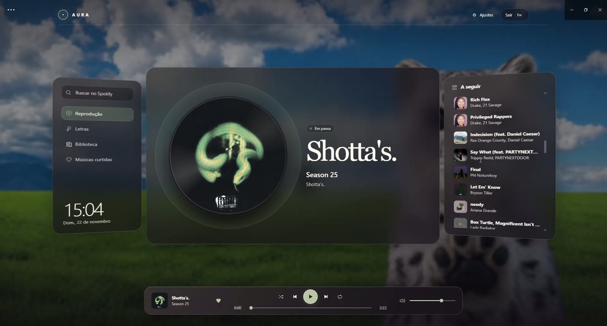
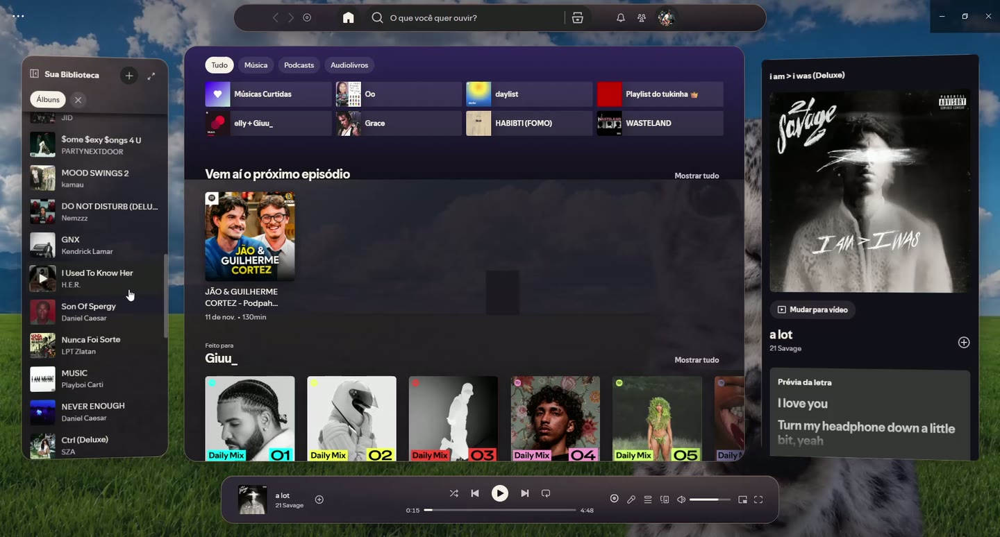

# AURA

[Português](README.md) · **English**

**A Spicetify theme and extension for Spotify on Windows.** AURA gives the library, browsing view, and Now Playing panel their own floating surfaces. Immersive mode turns the album cover into a spinning record.

[Demo](#demo) · [Installation](#installation) · [Spotify updates](#spotify-updates) · [Using AURA](#using-aura) · [Development](#development)

## Demo

[](docs/media/aura-demo.mp4)

[Watch the original recording · 53 s](docs/media/aura-demo.mp4)

## Features

### Desktop layout



- **Three floating panels with perspective** for your library, browsing, and the current track, plus a floating navigation bar and player.
- **Album-based lighting** along the panel edges, navigation bar, and player. The light changes with the current track and also works with custom wallpaper.
- **Animations across pages, menus, cards, and controls.** Start a track from a card to see its cover travel toward Now Playing or the player bar. Open an album to see its artwork expand into the header and return to the original card when that card is visible.
- **Two background modes.** Wallpaper uses your chosen image or the current album cover. Live desktop shows your desktop and other apps in the gaps between panels.

### Immersive mode

- **A spinning record with album artwork**, a customizable background, an optional clock, and controls for playback, volume, seeking, shuffle, repeat, and liked tracks.
- **A scrollable queue** that puts manually queued tracks above the upcoming album or playlist tracks. It stays in sync while playback is paused.
- **Lyrics in the side panel or below the record**, with word-by-word timing, line timing, or plain text depending on the track. [LRCLIB](https://lrclib.net/docs)
- **Saved settings** for color, wallpaper, keyboard shortcut, dimming, record size, and 3D depth. Reduce motion also applies to the desktop layout.

## Installation

### Tested versions

| Component | Version or purpose |
| --- | --- |
| Spotify for Windows | **1.3.9.2055**, from the desktop installer |
| Spicetify | **2.46.7** |
| PowerShell | PowerShell 7 recommended for AURA's Windows scripts. |
| Python 3 | Optional for Live desktop. The helper uses the `py.exe` launcher. |
| Node.js | Optional for running project checks. |

Spicetify 2.46.7 lists Windows compatibility through Spotify **1.3.9**. Check both versions before applying the theme. [Spicetify release notes](https://github.com/spicetify/cli/releases/tag/v2.46.7)

### 1. Set up Spotify and get AURA

Open Spotify and sign in. Install Spicetify using its Windows guide, then reopen PowerShell so the command is available. [Install Spicetify on Windows](https://spicetify.app/docs/getting-started#windows)

[Download the AURA ZIP](https://github.com/GiulioFreitaS/aura-spotify/archive/refs/heads/main.zip) and extract it, or clone the repository.

```powershell
git clone https://github.com/GiulioFreitaS/aura-spotify.git
Set-Location .\aura-spotify
```

To keep the compatible version, [block automatic updates](#spotify-updates) before quitting Spotify. Apply the protection as soon as the tested build is installed.

Open PowerShell in the folder containing `README.md`, `Themes`, and `Extensions`. Run `spicetify` to generate the configuration. On a fresh install, back up the original Spotify client. If you already use Spicetify, use your existing backup. [Spicetify CLI commands](https://spicetify.app/docs/cli/commands)

```powershell
spicetify --version
spicetify
spicetify backup
```

### 2. Apply AURA

Run this block from the project folder. It saves your previous configuration to a dated file. Keep the path it prints so you can restore that configuration later.

<details>
<summary>Show the installation commands</summary>

```powershell
$auraData = (spicetify path userdata).Trim()
$auraConfig = (spicetify -c).Trim()

if (!(Test-Path -LiteralPath $auraConfig -PathType Leaf)) {
    throw 'Run spicetify to generate config-xpui.ini before continuing.'
}

$auraFiles = [ordered]@{
    '.\Themes\AURA'            = 'Themes\AURA'
    '.\Extensions\aura.js'     = 'Extensions\aura.js'
    '.\Extensions\aura-lyrics' = 'Extensions\node_modules\aura-lyrics'
    '.\Extensions\aura-native' = 'Extensions\node_modules\aura-native'
}

foreach ($auraRelativePath in $auraFiles.Values) {
    $auraTarget = Join-Path $auraData $auraRelativePath
    if (Test-Path -LiteralPath $auraTarget) {
        throw 'AURA is already installed. See the Updating section.'
    }
}

$auraBackupName = 'AURA-config-' + (Get-Date -Format 'yyyyMMdd-HHmmssfff') + '.ini'
$auraBackup = Join-Path ([IO.Path]::GetTempPath()) $auraBackupName
Copy-Item -LiteralPath $auraConfig -Destination $auraBackup -ErrorAction Stop
Write-Output "Configuration backup saved to $auraBackup"

foreach ($auraFile in $auraFiles.GetEnumerator()) {
    $auraTarget = Join-Path $auraData $auraFile.Value
    $auraParent = Split-Path -Parent $auraTarget
    New-Item -ItemType Directory -Path $auraParent -Force -ErrorAction Stop | Out-Null
    Copy-Item -LiteralPath $auraFile.Key -Destination $auraTarget -Recurse -ErrorAction Stop
}

spicetify config extensions aura.js
if ($LASTEXITCODE -ne 0) { throw 'Could not enable the AURA extension.' }

spicetify config current_theme AURA color_scheme Vinil inject_css 1 replace_colors 1 expose_apis 1
if ($LASTEXITCODE -ne 0) { throw 'Could not select the AURA theme.' }

spicetify apply
if ($LASTEXITCODE -ne 0) { throw 'Could not apply AURA to Spotify.' }
```

</details>

### 3. Enable Live desktop (optional)

Install Python 3 with the `py.exe` launcher. Close Spotify, then run the launcher from the AURA folder to start Spotify and the local helper.

```powershell
.\Windows\Iniciar-AURA.ps1
```

In immersive mode, choose **Ajustes → Janela normal do Spotify → Fundo da janela → Desktop ao vivo**. When the helper is off, AURA's background fills the gaps between panels. [Windows window regions](https://learn.microsoft.com/en-us/windows/win32/api/winuser/nf-winuser-setwindowrgn)

## Spotify updates

The desktop client can update itself on the next launch and replace the files that load Spicetify. To keep Spotify at **1.3.9.2055**, run this command in PowerShell from the AURA folder.

```powershell
.\Windows\Atualizacoes-AURA.ps1 block
```

The block uses local permissions on `%LOCALAPPDATA%\Spotify\Update`. It applies when launching from the regular Spotify shortcut and after a Windows restart. If an update is already staged, the script saves its files in an adjacent `Update-AURA-*` folder. [Spicetify update folder protection](https://github.com/spicetify/cli/releases/tag/v3.0.0-beta.14)

| Action | Command |
| --- | --- |
| Check whether updates are blocked | `.\Windows\Atualizacoes-AURA.ps1 status` |
| Allow automatic updates again | `.\Windows\Atualizacoes-AURA.ps1 unblock` |
| Block updates and start AURA with its helper | `.\Windows\Iniciar-AURA.ps1 -BloquearAtualizacoes` |

### If Spotify returns to its default layout

If Spotify already updated, restore desktop version **1.3.9.2055** and block updates before restarting it. If you have already set up AURA, the launcher can reapply the customization and open Spotify.

```powershell
.\Windows\Iniciar-AURA.ps1 -BloquearAtualizacoes -Reaplicar
```

To use the theme and immersive mode on their own, run `spicetify apply` after blocking updates and closing Spotify.

## Using AURA

AURA's interface uses Portuguese labels. The table shows the exact settings and controls to look for.

| Action | Where to find it |
| --- | --- |
| Open immersive mode | Press **Ctrl + Alt + A**, or click the record icon in the player bar. The profile menu may also show **AURA · Modo imersivo**. |
| Return to Spotify | Press **Esc** or select **Sair**. From settings, the first **Esc** returns to immersive mode. |
| Toggle the floating panels | Use the AURA icon in the navigation bar or **AURA · Layout em painéis** in the profile menu. |
| Change the background | Open **Ajustes** in immersive mode to choose an image or switch back to album artwork. |
| Show lyrics | Select **Letras** in the side menu. Use **Ajustes → Letras** to change the placement or adjust the timing. |
| Reduce animations | Open **Ajustes → Reduzir movimento**. AURA also respects your Windows motion preferences. |

While showing lyrics, AURA queries LRCLIB with the track title, artist, album, and duration. Playback position drives the highlighting when timing data is available. You can shift the lyrics up to five seconds in either direction. [Lyricsfile format](https://github.com/tranxuanthang/lyricsfile/blob/main/SPECIFICATION.md)

## Updating

Back up your current files, then update `Themes\AURA\user.css`, `Extensions\aura.js`, and the `aura-lyrics` and `aura-native` modules under `Extensions\node_modules` in your Spicetify data folder. Keep `bridge-config.mjs` if the local helper has created it. Run `spicetify apply` to load the update. [Spicetify JavaScript modules](https://spicetify.app/docs/development/js-modules)

## Restoring your previous setup

If you use the local window helper, stop it before restoring. In a new PowerShell session, set `$auraBackup` to the path printed during installation.

```powershell
.\Windows\Iniciar-AURA.ps1 -Parar
Copy-Item -LiteralPath $auraBackup -Destination (spicetify -c).Trim() -Force -ErrorAction Stop
```

Run `spicetify apply` to reload your previous customizations. If you were using the original Spotify client before installing AURA, run `spicetify restore`. [Spicetify restore command](https://spicetify.app/docs/cli/commands#restore)

To allow future Spotify updates, run `.\Windows\Atualizacoes-AURA.ps1 unblock`.

## Development

| Folder | Contents |
| --- | --- |
| [Themes/AURA](Themes/AURA) | Theme styles and colors |
| [Extensions](Extensions) | Player integration, animations, and lyrics |
| [Windows](Windows) | Launcher, live desktop helper, and update protection |
| [tests](tests) | Lyrics parsing, timing, and lookup tests |

Run the checks from the project root.

```powershell
node --check .\Extensions\aura.js
node --test .\tests\lyrics.test.mjs
```

To test in Spotify, open an album and use the Back button in the floating navigation bar. Change tracks, pause, and check the record and queue. Switch between both backgrounds and test **Alt + Tab**. See the [decision log in Portuguese](docs/DECISOES.md) for implementation details.

## Credits

AURA is an independent customization for Spotify desktop built with [Spicetify](https://spicetify.app/). Lyrics come from [LRCLIB](https://lrclib.net/). The lyrics module includes [js-yaml and its license](Extensions/aura-lyrics/LICENSE-js-yaml.txt).
