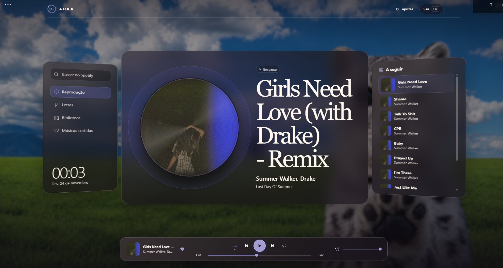
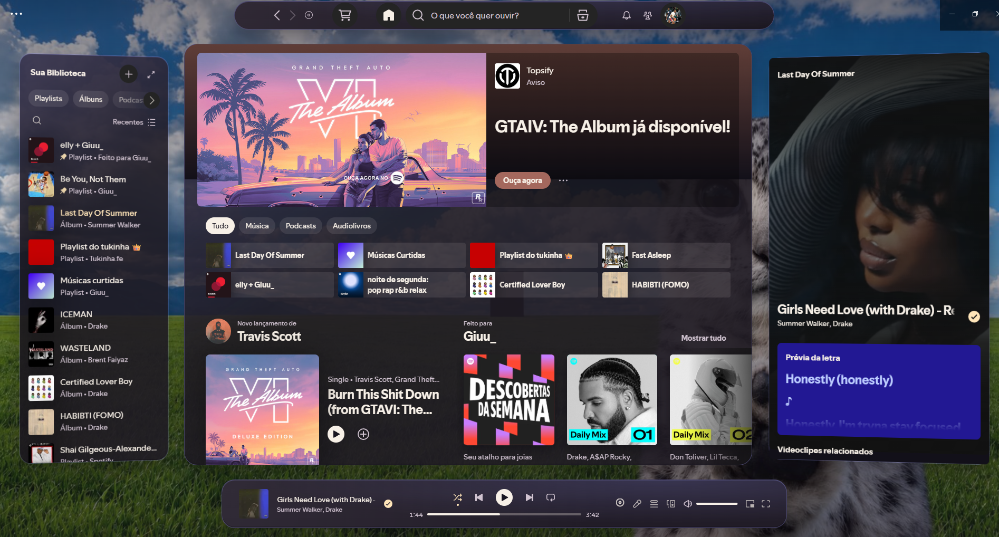
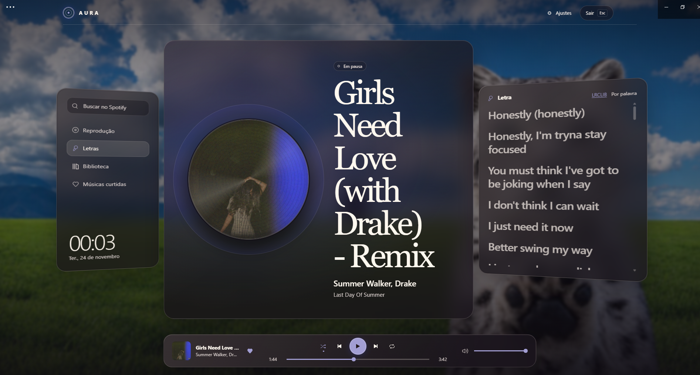

# AURA

**Português** · [English](README.en.md) · [Türkçe](README.tr.md)

**Tema e extensão para o Spotify desktop no Windows, Linux e macOS.** AURA coloca a biblioteca, a navegação e a reprodução em painéis flutuantes. O modo imersivo leva a capa para um vinil que gira junto com a música.

[Demonstração](#demonstração) · [Instalação](#instalação) · [Atualizações do Spotify](#atualizações-do-spotify) · [Como usar](#como-usar) · [Desenvolvimento](#desenvolvimento)

## Demonstração

### Modo imersivo com fila



### Janela do Spotify



### Letras no modo imersivo



## Recursos

### Janela do Spotify

- **Três painéis em perspectiva** para biblioteca, conteúdo e faixa atual, com uma ilha de navegação e um player flutuante.
- **Iluminação por álbum** nas bordas, na ilha e no player. A cor acompanha a faixa em reprodução, inclusive com um papel de parede personalizado.
- **Animações de navegação** em páginas, menus, cards e controles. Ao iniciar uma faixa, a miniatura viaja até o painel de reprodução. Ao abrir um álbum, a capa cresce até o cabeçalho e retorna ao card de origem se ele estiver visível.
- **Papel de parede configurável.** O AURA usa a capa do álbum por padrão. Para usar o papel de parede do sistema, escolha o arquivo da imagem nos ajustes. O mesmo fundo vale para a janela em painéis.

### Modo imersivo

- **Vinil com a capa inteira**, fundo configurável, relógio opcional e controles de reprodução, volume, posição na faixa, aleatório, repetição e curtidas.
- **Fila rolável** com as faixas adicionadas manualmente acima das próximas faixas do álbum ou da playlist. A fila acompanha o Spotify durante a pausa.
- **Letras no painel lateral ou abaixo do vinil**, com indicação de sincronização por palavra, por linha ou texto simples, conforme a faixa. [LRCLIB](https://lrclib.net/docs)
- **Ajustes persistentes** de cor, fundo, atalho, escurecimento, tamanho do disco e profundidade. **Reduzir movimento** também vale para a janela normal.

## Instalação

### Pelo Marketplace

1. Instale o Spicetify e o Marketplace pelo guia oficial.
2. No Spotify, abra **Marketplace → Temas** e procure **AURA**.
3. Instale o tema e reinicie o Spotify se o Marketplace pedir. O tema carrega o modo imersivo, a fila e as letras.

[Instalação do Spicetify e do Marketplace](https://spicetify.app/docs/getting-started)

### Compatibilidade

| Sistema | Faixas do Spotify suportadas pelo Spicetify 2.46.7 |
| --- | --- |
| Windows | 1.2.14 a 1.3.9 |
| Linux | 1.2.14 a 1.3.8 |
| macOS | 1.2.14 a 1.3.9 |

A referência de teste do AURA no cliente desktop é o Spotify **1.3.9.2055 no Windows**. A matriz do projeto exercita o pacote e a interface em Chromium no Windows, Linux e macOS. [Notas do Spicetify 2.46.7](https://github.com/spicetify/cli/releases/tag/v2.46.7)

### Instalação manual no Windows

#### 1. Preparar o Spotify e baixar o AURA

Abra o Spotify e entre com sua conta. Instale o Spicetify pelo guia oficial e reabra o PowerShell para reconhecer o comando. [Instalação do Spicetify no Windows](https://spicetify.app/docs/getting-started#windows)

[Baixe o ZIP do AURA](https://github.com/GiulioFreitaS/aura-spotify/archive/refs/heads/main.zip) e extraia a pasta, ou clone o repositório.

```powershell
git clone https://github.com/GiulioFreitaS/aura-spotify.git
Set-Location .\aura-spotify
```

Se quiser manter a versão compatível, [bloqueie as atualizações automáticas](#atualizações-do-spotify) antes de sair do Spotify. Aplique a proteção assim que a versão testada estiver instalada.

Abra o PowerShell na pasta que contém `README.md`, `Themes` e `Extensions`. Gere a configuração com `spicetify`. Em uma instalação nova, faça o backup inicial do Spotify original. Se já usa Spicetify, use o backup existente. [Comandos do Spicetify](https://spicetify.app/docs/cli/commands)

```powershell
spicetify --version
spicetify
spicetify backup
```

#### 2. Ativar o AURA

Execute o bloco na pasta do projeto. Ele guarda a configuração anterior em um arquivo datado. Anote o caminho exibido para poder restaurá-la.

<details>
<summary>Mostrar os comandos de instalação</summary>

```powershell
$auraData = (spicetify path userdata).Trim()
$auraConfig = (spicetify -c).Trim()

if (!(Test-Path -LiteralPath $auraConfig -PathType Leaf)) {
    throw 'Execute spicetify para gerar config-xpui.ini antes de continuar.'
}

$auraFiles = [ordered]@{
    '.\Themes\AURA'            = 'Themes\AURA'
    '.\Extensions\aura.js'     = 'Extensions\aura.js'
    '.\Extensions\aura-lyrics' = 'Extensions\node_modules\aura-lyrics'
    '.\Extensions\aura-native' = 'Extensions\node_modules\aura-native'
}

foreach ($auraRelativePath in $auraFiles.Values) {
    $auraTarget = Join-Path $auraData $auraRelativePath
    if (Test-Path -LiteralPath $auraTarget) {
        throw 'Já existe uma instalação do AURA. Consulte a seção Atualizar.'
    }
}

$auraBackupName = 'AURA-config-' + (Get-Date -Format 'yyyyMMdd-HHmmssfff') + '.ini'
$auraBackup = Join-Path ([IO.Path]::GetTempPath()) $auraBackupName
Copy-Item -LiteralPath $auraConfig -Destination $auraBackup -ErrorAction Stop
Write-Output "Backup da configuração em $auraBackup"

foreach ($auraFile in $auraFiles.GetEnumerator()) {
    $auraTarget = Join-Path $auraData $auraFile.Value
    $auraParent = Split-Path -Parent $auraTarget
    New-Item -ItemType Directory -Path $auraParent -Force -ErrorAction Stop | Out-Null
    Copy-Item -LiteralPath $auraFile.Key -Destination $auraTarget -Recurse -ErrorAction Stop
}

spicetify config extensions aura.js
if ($LASTEXITCODE -ne 0) { throw 'Falha ao ativar a extensão AURA.' }

spicetify config current_theme AURA color_scheme Vinil inject_css 1 replace_colors 1 expose_apis 1
if ($LASTEXITCODE -ne 0) { throw 'Falha ao selecionar o tema AURA.' }

spicetify apply
if ($LASTEXITCODE -ne 0) { throw 'Falha ao aplicar o AURA ao Spotify.' }
```

</details>

## Atualizações do Spotify

Ao atualizar o Spotify, confira a compatibilidade e reaplique o Spicetify. [Atualizações do Spicetify](https://spicetify.app/docs/getting-started#updating)

No Windows, o cliente pode atualizar na próxima abertura e substituir os arquivos que carregam o Spicetify. Para manter o Spotify na **1.3.9.2055**, use o comando abaixo no PowerShell, na pasta do AURA.

```powershell
.\Windows\Atualizacoes-AURA.ps1 block
```

O bloqueio usa permissões locais na pasta `%LOCALAPPDATA%\Spotify\Update`. Ele vale ao abrir pelo atalho normal e após reiniciar o Windows. Se já existir uma atualização pendente, o script guarda os arquivos em uma pasta `Update-AURA-*` ao lado. [Proteção do atualizador no Spicetify](https://github.com/spicetify/cli/releases/tag/v3.0.0-beta.14)

| Quando usar | Comando |
| --- | --- |
| Conferir o bloqueio | `.\Windows\Atualizacoes-AURA.ps1 status` |
| Liberar as atualizações | `.\Windows\Atualizacoes-AURA.ps1 unblock` |
| Bloquear e abrir o Spotify | `.\Windows\Iniciar-AURA.ps1 -BloquearAtualizacoes` |

### Quando o layout volta ao padrão

Se o Spotify já atualizou, volte à **1.3.9.2055** do instalador desktop e aplique o bloqueio antes de reiniciar o cliente. Se já tiver ativado o AURA, o iniciador pode reaplicar a personalização e abrir o Spotify em seguida.

```powershell
.\Windows\Iniciar-AURA.ps1 -BloquearAtualizacoes -Reaplicar
```

Para reaplicar o AURA instalado manualmente, execute `spicetify apply` depois de bloquear as atualizações e fechar o Spotify.

## Como usar

| Ação | Onde encontrar |
| --- | --- |
| Abrir o modo imersivo | **Ctrl + Alt + A** (Control + Option + A no macOS) ou botão com ícone de disco no player. O menu do perfil também pode oferecer **AURA · Modo imersivo**. |
| Voltar ao Spotify | **Esc** ou **Sair**. Nos ajustes, o primeiro **Esc** volta ao modo imersivo. |
| Alternar o layout em painéis | Ícone do AURA na ilha de navegação ou **AURA · Layout em painéis** no perfil. |
| Mudar o fundo | **Ajustes** no modo imersivo. É possível escolher uma imagem ou voltar a usar a capa do álbum. |
| Mostrar letras | **Letras** no menu lateral. Use **Ajustes → Letras** para mudar a posição ou corrigir a sincronia. |
| Reduzir as animações | **Ajustes → Reduzir movimento**. O AURA também respeita a preferência de movimento reduzido do sistema. |

O AURA lê o idioma do Spotify ao abrir. A interface está disponível em português, inglês e turco. Para outros idiomas do Spotify, o AURA usa inglês.

O AURA consulta o LRCLIB ao exibir letras, usando título, artista, álbum e duração. A posição da música controla o destaque quando o resultado tem marcações de tempo. O atraso manual aceita até cinco segundos em cada direção. [Formato Lyricsfile](https://github.com/tranxuanthang/lyricsfile/blob/main/SPECIFICATION.md)

## Atualizar

Pelo Marketplace, abra **Instalados** e aplique a atualização quando estiver disponível.

Para a instalação manual no Windows, guarde uma cópia dos arquivos atuais e atualize `Themes\AURA\user.css`, `Extensions\aura.js` e os módulos `aura-lyrics` e `aura-native` em `Extensions\node_modules` na pasta de dados do Spicetify. Rode `spicetify apply` para carregar a atualização. [Módulos JavaScript do Spicetify](https://spicetify.app/docs/development/js-modules)

## Voltar à configuração anterior

Pelo Marketplace, remova o AURA em **Instalados**.

Para restaurar a instalação manual no Windows, atribua a `$auraBackup` o caminho guardado na instalação.

```powershell
Copy-Item -LiteralPath $auraBackup -Destination (spicetify -c).Trim() -Force -ErrorAction Stop
```

Use `spicetify apply` para reaplicar seus ajustes anteriores. Se o Spotify estava original antes da instalação, use `spicetify restore`. [Restauração do Spicetify](https://spicetify.app/docs/cli/commands#restore)

Para liberar futuras atualizações do Spotify, execute `.\Windows\Atualizacoes-AURA.ps1 unblock`.

## Desenvolvimento

| Pasta | Conteúdo |
| --- | --- |
| [Themes/AURA](Themes/AURA) | Estilos e paleta do tema |
| [Extensions](Extensions) | Extensão, integração com o player, animações e letras |
| [Windows](Windows) | Iniciador e proteção da versão do Spotify para Windows |
| [tests](tests) | Verificações de letras e da interface do Marketplace |

O manifesto aponta para o tema, a paleta, a prévia e o script empacotado que o GitHub Pages serve ao Marketplace.

Rode na raiz do projeto com Node.js 22 ou superior.

```sh
npm ci
npm test
npm run build:marketplace
npx playwright install chromium
npm run test:marketplace
```

Para testar no Spotify, troque de faixa e confira o vinil, a fila e as letras. Escolha um fundo local e volte à capa do álbum. Veja o [histórico de decisões](docs/DECISOES.md).

## Créditos

AURA é uma personalização independente que usa [Spicetify](https://spicetify.app/) no Spotify desktop. As letras vêm do [LRCLIB](https://lrclib.net/). O módulo de letras inclui [js-yaml e sua licença](Extensions/aura-lyrics/LICENSE-js-yaml.txt).
