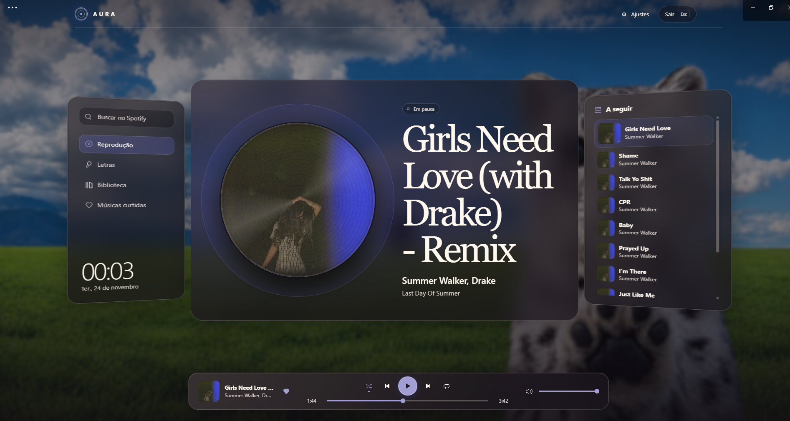
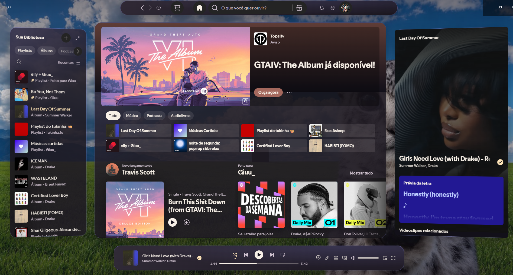
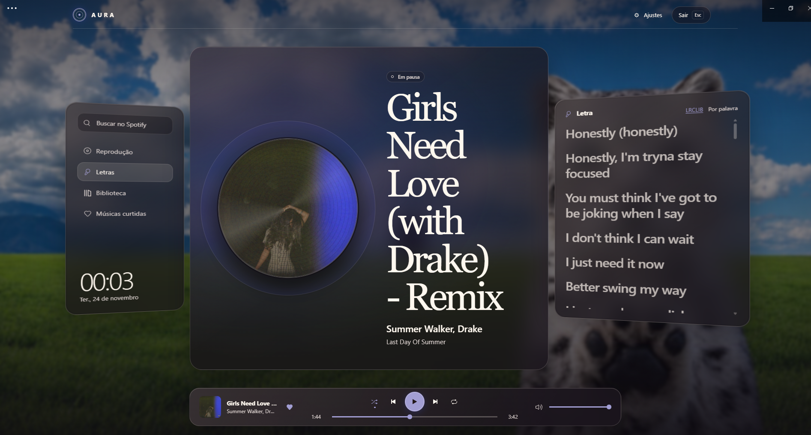

# AURA

[Português](README.md) · [English](README.en.md) · **Türkçe**

**Windows, Linux ve macOS'taki Spotify masaüstü uygulaması için bir Spicetify teması ve eklentisi.** AURA; kitaplığı, gezinme alanını ve “Şimdi Çalıyor” panelini ayrı yüzen yüzeylere yerleştirir. Sürükleyici modda albüm kapağı dönen bir plağa dönüşür.

[Tanıtım](#tanıtım) · [Kurulum](#kurulum) · [Spotify güncellemeleri](#spotify-güncellemeleri) · [Kullanım](#kullanım) · [Geliştirme](#geliştirme)

## Tanıtım

### Sürükleyici mod ve çalma sırası



### Masaüstü düzeni



### Sürükleyici modda şarkı sözleri



## Özellikler

### Masaüstü düzeni

- Kitaplık, gezinme ve çalan parça için **perspektifli üç yüzen panel**, ayrıca yüzen bir gezinme çubuğu ve oynatıcı.
- Panel kenarlarında, gezinme çubuğunda ve oynatıcıda **albüme göre ışıklandırma**. Işık, çalan parçayla birlikte değişir ve özel duvar kâğıdıyla da çalışır.
- **Sayfalarda, menülerde, kartlarda ve kontrollerde animasyonlar.** Bir karttan parça başlattığında kapağı “Şimdi Çalıyor” paneline veya oynatıcı çubuğuna doğru ilerler. Bir albümü açtığında kapağı başlığa doğru büyür; kaynak kart görünür durumdaysa geri dönerken o karta döner.
- **Özelleştirilebilir duvar kâğıdı.** AURA varsayılan olarak albüm kapağını kullanır. Sistem duvar kâğıdınla eşleştirmek için sürükleyici modun ayarlarından görsel dosyasını seç. Aynı arka plan, yüzen panellerin arkasındaki alanı da doldurur.

### Sürükleyici mod

- **Albüm kapaklı dönen plak**, özelleştirilebilir arka plan, isteğe bağlı saat ve oynatma, ses, parçada konum, karışık çalma, tekrar ve beğenme kontrolleri.
- Elle sıraya eklenen parçaları albüm veya çalma listesindeki sonraki parçaların üstünde gösteren **kaydırılabilir çalma sırası**. Oynatma duraklatılmışken de eşzamanlı kalır.
- **Yan panelde veya plağın altında şarkı sözleri**; parçaya göre kelime kelime eşzamanlı, satır satır eşzamanlı veya düz metin. [LRCLIB](https://lrclib.net/docs)
- Renk, duvar kâğıdı, klavye kısayolu, karartma, plak boyutu ve 3B derinlik için **kaydedilen ayarlar**. **Hareketi azalt** seçeneği masaüstü düzeni için de geçerlidir.

## Kurulum

### Marketplace üzerinden

1. Resmî kılavuzu izleyerek Spicetify ve Marketplace'i kur.
2. Spotify'da **Marketplace → Themes** bölümünü aç ve **AURA** diye ara.
3. Temayı kur; istenirse Spotify'ı yeniden başlat. AURA; sürükleyici oynatıcıyı, çalma sırasını ve şarkı sözlerini temayla birlikte yükler.

[Spicetify ve Marketplace kurulumu](https://spicetify.app/docs/getting-started)

### Uyumluluk

| Platform | Spicetify 2.46.7'nin desteklediği Spotify sürümleri |
| --- | --- |
| Windows | 1.2.14 – 1.3.9 |
| Linux | 1.2.14 – 1.3.8 |
| macOS | 1.2.14 – 1.3.9 |

AURA'nın Spotify masaüstü uygulamasındaki test referansı **Windows'ta 1.3.9.2055** sürümüdür. Depodaki testler paketi ve arayüzü Windows, Linux ve macOS üzerinde Chromium ile sınar. [Spicetify 2.46.7 sürüm notları](https://github.com/spicetify/cli/releases/tag/v2.46.7)

### Windows'ta elle kurulum

#### 1. Spotify'ı hazırla ve AURA'yı indir

Spotify'ı açıp oturum aç. Spicetify'ı Windows kılavuzuna göre kur, ardından komutun tanınması için PowerShell'i yeniden aç. [Windows'a Spicetify kurulumu](https://spicetify.app/docs/getting-started#windows)

[AURA ZIP dosyasını indirip](https://github.com/GiulioFreitaS/aura-spotify/archive/refs/heads/main.zip) klasöre çıkar veya depoyu klonla.

```powershell
git clone https://github.com/GiulioFreitaS/aura-spotify.git
Set-Location .\aura-spotify
```

Uyumlu sürümde kalmak için Spotify'dan çıkmadan önce [otomatik güncellemeleri engelle](#spotify-güncellemeleri). Test edilen sürüm kurulur kurulmaz korumayı uygula.

`README.md`, `Themes` ve `Extensions` öğelerini içeren klasörde PowerShell'i aç. Yapılandırmayı oluşturmak için `spicetify` komutunu çalıştır. Yeni bir kurulumda özgün Spotify istemcisini yedekle. Spicetify'ı zaten kullanıyorsan mevcut yedeğini kullan. [Spicetify CLI komutları](https://spicetify.app/docs/cli/commands)

```powershell
spicetify --version
spicetify
spicetify backup
```

#### 2. AURA'yı etkinleştir

Aşağıdaki bloğu proje klasöründe çalıştır. Blok, önceki yapılandırmanı tarihli bir dosyaya kaydeder. Daha sonra geri yükleyebilmek için ekrana yazdırılan yolu sakla.

<details>
<summary>Kurulum komutlarını göster</summary>

```powershell
$auraData = (spicetify path userdata).Trim()
$auraConfig = (spicetify -c).Trim()

if (!(Test-Path -LiteralPath $auraConfig -PathType Leaf)) {
    throw 'Devam etmeden önce spicetify komutunu çalıştırarak config-xpui.ini dosyasını oluştur.'
}

$auraFiles = [ordered]@{
    '.\Themes\AURA'            = 'Themes\AURA'
    '.\Extensions\aura.js'     = 'Extensions\aura.js'
    '.\Extensions\aura-lyrics' = 'Extensions\node_modules\aura-lyrics'
    '.\Extensions\aura-native' = 'Extensions\node_modules\aura-native'
}

foreach ($auraRelativePath in $auraFiles.Values) {
    $auraTarget = Join-Path $auraData $auraRelativePath
    if (Test-Path -LiteralPath $auraTarget) {
        throw 'AURA zaten kurulu. Güncelleme bölümüne bak.'
    }
}

$auraBackupName = 'AURA-config-' + (Get-Date -Format 'yyyyMMdd-HHmmssfff') + '.ini'
$auraBackup = Join-Path ([IO.Path]::GetTempPath()) $auraBackupName
Copy-Item -LiteralPath $auraConfig -Destination $auraBackup -ErrorAction Stop
Write-Output "Yapılandırma yedeği şuraya kaydedildi: $auraBackup"

foreach ($auraFile in $auraFiles.GetEnumerator()) {
    $auraTarget = Join-Path $auraData $auraFile.Value
    $auraParent = Split-Path -Parent $auraTarget
    New-Item -ItemType Directory -Path $auraParent -Force -ErrorAction Stop | Out-Null
    Copy-Item -LiteralPath $auraFile.Key -Destination $auraTarget -Recurse -ErrorAction Stop
}

spicetify config extensions aura.js
if ($LASTEXITCODE -ne 0) { throw 'AURA eklentisi etkinleştirilemedi.' }

spicetify config current_theme AURA color_scheme Vinil inject_css 1 replace_colors 1 expose_apis 1
if ($LASTEXITCODE -ne 0) { throw 'AURA teması seçilemedi.' }

spicetify apply
if ($LASTEXITCODE -ne 0) { throw 'AURA, Spotify''a uygulanamadı.' }
```

</details>

## Spotify güncellemeleri

Spotify güncellendikten sonra sürüm uyumluluğunu kontrol et ve Spicetify'ı yeniden uygula. [Spicetify güncellemeleri](https://spicetify.app/docs/getting-started#updating)

Windows'ta masaüstü istemcisi açılışta kendini güncelleyip Spicetify'ı yükleyen dosyaların üzerine yazabilir. Spotify'ı **1.3.9.2055** sürümünde tutmak için AURA klasöründe PowerShell ile şu komutu çalıştır.

```powershell
.\Windows\Atualizacoes-AURA.ps1 block
```

> Not: `Windows` klasöründeki betiklerin ekran iletileri Portekizcedir.

Engelleme, `%LOCALAPPDATA%\Spotify\Update` klasöründeki yerel izinleri kullanır. Spotify normal kısayoldan açıldığında ve Windows yeniden başlatıldıktan sonra da geçerlidir. Bekleyen bir güncelleme varsa betik, dosyalarını bitişikteki bir `Update-AURA-*` klasörüne kaydeder. [Spicetify güncelleme klasörü koruması](https://github.com/spicetify/cli/releases/tag/v3.0.0-beta.14)

| İşlem | Komut |
| --- | --- |
| Güncellemelerin engellenip engellenmediğini denetle | `.\Windows\Atualizacoes-AURA.ps1 status` |
| Otomatik güncellemelere yeniden izin ver | `.\Windows\Atualizacoes-AURA.ps1 unblock` |
| Güncellemeleri engelle ve Spotify'ı başlat | `.\Windows\Iniciar-AURA.ps1 -BloquearAtualizacoes` |

### Spotify varsayılan düzenine dönerse

Spotify güncellendiyse masaüstü **1.3.9.2055** sürümünü geri yükle ve istemciyi yeniden başlatmadan önce güncellemeleri engelle. AURA'yı daha önce kurduysan başlatıcı, özelleştirmeyi yeniden uygulayıp Spotify'ı açabilir.

```powershell
.\Windows\Iniciar-AURA.ps1 -BloquearAtualizacoes -Reaplicar
```

Elle yapılan bir kurulumu yeniden uygulamak için güncellemeleri engelleyip Spotify'ı kapattıktan sonra `spicetify apply` komutunu çalıştır.

## Kullanım

| İşlem | Nerede bulunur? |
| --- | --- |
| Sürükleyici modu açma | **Ctrl + Alt + A** (macOS'ta Control + Option + A) tuşlarına bas veya oynatıcı çubuğundaki plak simgesine tıkla. Profil menüsünde **AURA · Sürükleyici mod** seçeneği de görünebilir. |
| Spotify'a dönme | **Esc** tuşuna bas veya **Çık** seçeneğini kullan. Ayarlar açıkken ilk **Esc** sürükleyici moda döndürür. |
| Yüzen panelleri açıp kapatma | Gezinme çubuğundaki AURA simgesini veya profil menüsündeki **AURA · Yüzen paneller** seçeneğini kullan. |
| Arka planı değiştirme | Görsel seçmek veya albüm kapağına dönmek için sürükleyici modda **Ayarlar** bölümünü aç. |
| Şarkı sözlerini gösterme | Yan menüden **Şarkı sözleri** seçeneğini kullan. Konumu veya zamanlamayı **Ayarlar → Şarkı sözleri** bölümünden değiştir. |
| Animasyonları azaltma | **Ayarlar → Hareketi azalt** seçeneğini aç. AURA, sistemindeki hareketi azaltma tercihine de uyar. |

AURA açılırken Spotify'ın dilini okur. Arayüz Türkçe, İngilizce ve Portekizce olarak kullanılabilir; diğer Spotify dillerinde İngilizce gösterilir.

Şarkı sözleri gösterilirken AURA; parça adı, sanatçı, albüm ve süre bilgisiyle LRCLIB'i sorgular. Zamanlama verisi varsa vurgulama, oynatma konumuna göre ilerler. Sözleri her iki yönde beş saniyeye kadar kaydırabilirsin. [Lyricsfile biçimi](https://github.com/tranxuanthang/lyricsfile/blob/main/SPECIFICATION.md)

## Güncelleme

Marketplace kurulumlarında, güncelleme çıktığında **Installed** bölümünden uygula.

Windows'ta elle yapılan bir kurulum için önce mevcut dosyalarını yedekle. Ardından Spicetify veri klasöründeki `Themes\AURA\user.css` ve `Extensions\aura.js` dosyalarını, ayrıca `Extensions\node_modules` altındaki `aura-lyrics` ve `aura-native` modüllerini güncelle. Güncellemeyi yüklemek için `spicetify apply` komutunu çalıştır. [Spicetify JavaScript modülleri](https://spicetify.app/docs/development/js-modules)

## Önceki kuruluma dönme

Marketplace kurulumlarında AURA'yı **Installed** bölümünden kaldır.

Windows'ta elle yapılan kurulum için `$auraBackup` değişkenine kurulum sırasında yazdırılan yolu ata.

```powershell
Copy-Item -LiteralPath $auraBackup -Destination (spicetify -c).Trim() -Force -ErrorAction Stop
```

Önceki özelleştirmelerini yeniden yüklemek için `spicetify apply` komutunu çalıştır. AURA'yı kurmadan önce özgün Spotify istemcisini kullanıyorsan `spicetify restore` komutunu çalıştır. [Spicetify restore komutu](https://spicetify.app/docs/cli/commands#restore)

İleride gelecek Spotify güncellemelerine izin vermek için `.\Windows\Atualizacoes-AURA.ps1 unblock` komutunu çalıştır.

## Geliştirme

| Klasör | İçerik |
| --- | --- |
| [Themes/AURA](Themes/AURA) | Tema stilleri ve renkleri |
| [Extensions](Extensions) | Oynatıcı entegrasyonu, animasyonlar ve şarkı sözleri |
| [Windows](Windows) | Windows için başlatıcı ve Spotify sürüm koruması |
| [tests](tests) | Şarkı sözü ve Marketplace arayüz testleri |

Kök dizindeki manifest dosyası; temayı, renk paletini, önizlemeyi ve GitHub Pages'in Marketplace'e sunduğu paketlenmiş betiği gösterir.

Testleri proje kök dizininde Node.js 22 veya üzeri bir sürümle çalıştır.

```sh
npm ci
npm test
npm run build:marketplace
npx playwright install chromium
npm run test:marketplace
```

Spotify'da parça değiştirip plağı, çalma sırasını ve şarkı sözlerini kontrol et. Yerel bir görsel seç, ardından albüm kapağına geri dön. [Portekizce karar günlüğüne](docs/DECISOES.md) de bakabilirsin.

## Katkıda bulunanlar ve kaynaklar

AURA, [Spicetify](https://spicetify.app/) ile geliştirilmiş, Spotify masaüstü uygulamasına yönelik bağımsız bir özelleştirmedir. Şarkı sözleri [LRCLIB](https://lrclib.net/) kaynağından gelir. Şarkı sözü modülü [js-yaml ve lisansını](Extensions/aura-lyrics/LICENSE-js-yaml.txt) içerir.
